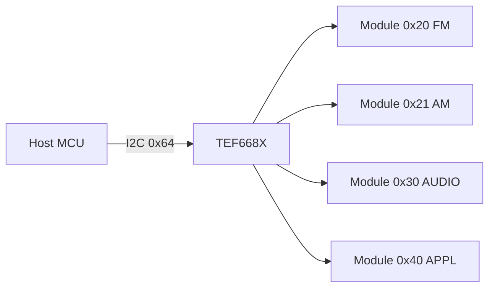
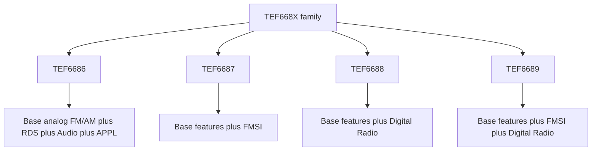
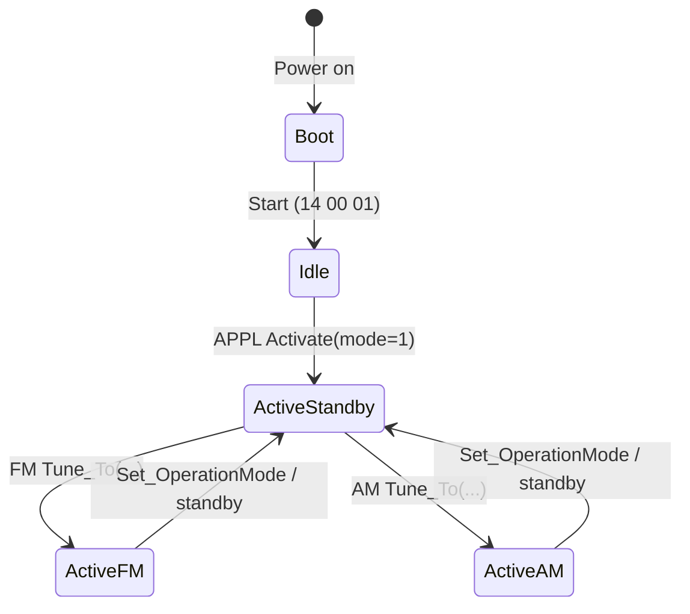
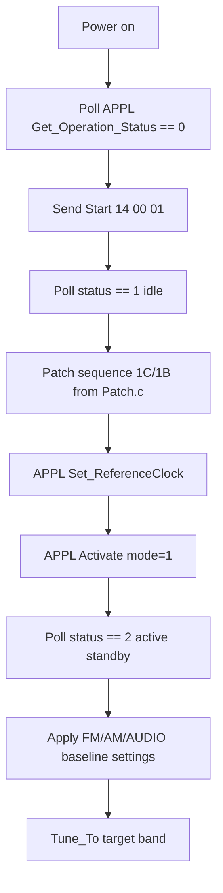

# TEF668X Full Library Specification (TEF6686/87/88/89, V102)

This document is the implementation blueprint for a full TEF668X library.
It combines:
- Official user manual: `UM_Radio_TEF668X_V102.pdf`
- Official patch package: `Patch.c` / `Patches.h` (p2.24)
- Working driver profile values from `tef6686done.ino`

## Abbreviations and meanings

This section expands the short names used in the TEF668X manuals and in this document.

- `APPL` = `Application control module`
  Use: system-level control of the chip. This is where you handle activation, reference clock, GPIO setup, chip identification, operation status, and other global functions.

- `FM` = `Frequency Modulation radio module`
  Use: all FM-radio controls such as tuning, bandwidth, stereo, RDS, multipath suppression, softmute, highcut, and FM quality readback.

- `AM` = `Amplitude Modulation radio module`
  Use: all AM-band controls such as LW/MW/SW tuning, bandwidth, antenna settings, noise blanker, co-channel detection, and AM quality readback.

- `AUDIO` = `Audio processing module`
  Use: output volume, mute, input routing, analog output mode, digital audio I/O, input scaling, and internal test tone generation.

- `RDS` = `Radio Data System`
  Use: FM station data such as PI, PS name, RadioText, and group blocks read through `Get_RDS_Status` and `Get_RDS_Data`.

- `GPIO` = `General Purpose Input/Output`
  Use: configurable chip pins that can be assigned to status or interface functions such as interrupts or radio-related signals.

- `I2C` = `Inter-Integrated Circuit`
  Use: the serial bus used to control the TEF668X. All module commands are sent over I2C.

- `LUT` = `Look-Up Table`
  Use: part of the official startup patch package. It is uploaded after the main patch bytes during initialization.

- `AGC` = `Automatic Gain Control`
  Use: automatic control of RF/input gain to avoid overload and improve reception over changing signal levels.

- `RF` = `Radio Frequency`
  Use: front-end signal path before demodulation. In the manual it appears in controls such as `Set_RFAGC`.

- `DR` = `Digital Radio`
  Use: digital-radio interface and blend features. Important: this is not available on TEF6686; it is for TEF6688/6689 only.

- `FMSI` = `FM Stereo Improvement`
  Use: advanced stereo enhancement system available only on TEF6687 and TEF6689. It adds extra stereo-band blend controls beyond the standard TEF6686 stereo path.

- `USN`
  Meaning in manual context: FM noise-related quality metric used by the chip for weak-signal control.
  Use: used by commands like `Set_SoftMute_Noise`, `Set_HighCut_Noise`, and `Set_Stereo_Noise` to react to FM noise conditions.

- `WAM`
  Meaning in manual context: FM multipath-related quality metric used by the chip.
  Use: used by commands like `Set_SoftMute_Mph`, `Set_HighCut_Mph`, and `Set_Stereo_Mph` to react to reflections and mobile multipath distortion.

- `MPH` = `Multipath`
  Use: weak-signal distortion caused by reflected RF paths. In TEF668X documents, controls with `Mph` or `MphSuppression` handle this behavior.

- `PACS`
  Meaning in manual context: automatic FM bandwidth control behavior used by the tuner.
  Use: when FM bandwidth is set to automatic mode, the chip can adapt IF bandwidth dynamically for reception conditions.

- `IF` = `Intermediate Frequency`
  Use: internal filtering and bandwidth control stage between RF reception and audio/data demodulation.

- `dBuV` = `decibels referenced to 1 microvolt`
  Use: signal-level unit used for RF thresholds like AGC start, stereo start, softmute start, and highcut start.

- `dB` = `decibel`
  Use: generic gain/attenuation unit used for volume, scaler, slopes, blend gain, and offsets.

- `kHz` = `kilohertz`
  Use: tuning frequency unit and bandwidth unit in many commands.

- `Hz` = `hertz`
  Use: used for audio filter corner frequencies, wave generator settings, and some interface clock-related values.

- `ms` = `milliseconds`
  Use: attack, decay, mute, and sampling timing parameters.

- `PI` = `Program Identification`
  Use: RDS station identifier code.

- `PS` = `Program Service`
  Use: RDS station name text, usually the short 8-character display name.

- `RT` = `RadioText`
  Use: RDS text message sent by the station, often song/title or station information.

- `DAC` = `Digital-to-Analog Converter`
  Use: analog audio output path controlled by audio output configuration commands.

- `I2S` = `Integrated Interchip Sound`
  Use: digital audio serial interface used for audio output and digital-radio-related paths on supported variants.

- `LSB` = `Least Significant Bit`
  Use: appears in test-wave/audio generator descriptions where audio offsets or amplitudes are expressed in sample steps.

- `HI cut` / `HighCut`
  Meaning: dynamic treble reduction under weak or noisy conditions.
  Use: reduces high-frequency audio content to hide hiss and make weak stations more listenable.

- `LowCut`
  Meaning: dynamic or fixed bass/subsonic reduction.
  Use: helps suppress rumble, DC, and low-frequency artifacts under weak-signal conditions.

- `SoftMute`
  Meaning: progressive attenuation on poor signal conditions.
  Use: hides noise and hiss when the station becomes weak.

- `StHiBlend` = `Stereo High Blend`
  Meaning: stereo separation reduction mainly in higher audio frequencies.
  Use: preserves listenability on weak FM without collapsing the full stereo image as early as full mono blend.

- `Scaler`
  Meaning: signal gain/attenuation trim.
  Use: lets you shift level in dB for FM/AM or audio paths without changing the rest of the profile.

## 1) Scope and goals

Target: a reusable C/C++ library that fully controls TEF668X over I2C.

Platform target:
- Arduino-compatible boards
- ESP-based boards such as `ESP32` and `ESP8266` where supported by the chosen Arduino core

The design goal is not a PC or Linux driver first. The primary goal is an embedded library that can be dropped into Arduino sketches and ESP projects with minimal changes.

Required capabilities:
- Device lifecycle control (boot -> idle -> active -> FM/AM)
- Patch and LUT upload
- Full FM/AM write API
- Full AUDIO and APPL write API
- Full FM/AM/APPL read API
- Clear value units, ranges, and conversion helpers
- Safe sequencing rules (timing + state constraints)
- Arduino and ESP portability

## 1.1) Arduino and ESP support requirement

This library should be written so the same codebase supports:
- classic Arduino environments such as AVR boards
- ESP Arduino environments such as ESP32 and ESP8266

Practical meaning:
- use standard Arduino-style I2C access through `TwoWire`
- avoid platform-specific code in the high-level TEF668X logic
- isolate board-specific behavior into a very small transport/config layer
- keep memory usage reasonable because patch/LUT storage matters on microcontrollers

Recommended approach:
- provide a transport interface that accepts a `TwoWire&`
- allow the caller to choose the I2C bus object, for example `Wire` or another `TwoWire`
- avoid hardcoding AVR-only items such as `PROGMEM` into the public API layer
- if `PROGMEM` is used for AVR efficiency, hide it behind compatibility macros so ESP builds still work cleanly

Recommended public initialization style:

```cpp
bool begin(TwoWire& wire = Wire, uint8_t i2cAddr = 0x64);
bool initHard(uint32_t crystalHz = 9216000UL);
bool initSoft(uint32_t crystalHz = 9216000UL);
```

Recommended compatibility rule:
- all TEF668X command code should be platform-neutral C++
- only the patch-byte storage and low-level I2C write/read helpers should need small Arduino/ESP compatibility handling

## 2) Device model

TEF668X modules:
- `0x20` (32): FM
- `0x21` (33): AM
- `0x30` (48): AUDIO
- `0x40` (64): APPL

I2C device address used in your code:
- `0x64` (7-bit)

### Mermaid: module map



## 2.1) Variant clarification

This project should target `TEF6686` first.

From the official V102 manual:
- `TEF6686`: base Lithio device
- `TEF6687`: TEF6686 + FMSI stereo improvement
- `TEF6688`: TEF6686 + digital radio connectivity/support
- `TEF6689`: TEF6686 + FMSI + digital radio

What this means for your library:
- The `TEF6686` supports the full analog radio path: FM, AM, audio control, RDS, quality readback, AGC readback, processing readback, patch loading, and application control.
- The `TEF6686` does **not** have FMSI-only stereo enhancement features.
- The `TEF6686` does **not** have digital-radio interface/blend features.

### TEF6686 feature set that should be present

- FM reception
- AM reception
- RDS decode and RDS data read
- FM weak-signal processing:
  - SoftMute
  - HighCut / LowCut
  - Stereo blend
  - StHiBlend
  - Multipath suppression
  - Channel equalizer
  - Noise blanker
- Audio controls:
  - volume
  - mute
  - input selection
  - analog output control
  - digital audio output control for normal audio path
- APPL/system controls:
  - operation mode
  - GPIO
  - reference clock
  - activate
  - identification
  - last write

### Variant-only features that should be marked optional

- `TEF6687` / `TEF6689` only:
  - `FM cmd 32` `Set_StereoImprovement`
  - `FM cmd 90..92` `Set_StBandBlend_*`
  - Extra FMSI status fields in `Get_Processing_Status`

- `TEF6688` / `TEF6689` only:
  - `FM/AM cmd 30` `Set_DigitalRadio`
  - `FM/AM cmd 83` `Set_DR_Blend`
  - `FM/AM cmd 84` `Set_DR_Options`
  - Digital-radio-related parts of `cmd 85`
  - `FM/AM cmd 135` `Get_Interface_Status`
  - DR pins / DR blend path

### Recommended implementation rule

The library should separate commands into:
- `always available on TEF6686`
- `available only on FMSI variants`
- `available only on DR variants`

That way the TEF6686 build stays clean and we avoid exposing functions that your chip cannot use.

### Variant detection

Use `APPL cmd 130 Get_Identification` during initialization.

Manual variant identifiers:
- `14` = `TEF6686`
- `1` = `TEF6687`
- `9` = `TEF6688`
- `3` = `TEF6689`

Recommended library behavior:
- Read identification once during init
- Store detected variant in driver state
- Reject unsupported variant-only commands with a clear error code

### Mermaid: variant map



### Command frame

Write frame:
- `[module][cmd][index][param_hi][param_lo]...`

Read frame:
1. Write request header: `[module][cmd][index]`
2. Repeated start + read `N*2` bytes

Notes:
- Parameters are 16-bit words.
- Some params are signed (two's complement), especially gains/volume/scaler.
- In V102, send full parameter set for each command (no partial writes).

## 3) State machine and timing

Operation states from `APPL Get_Operation_Status` (`module 0x40`, `cmd 128`):
- `0`: boot
- `1`: idle
- `2`: active standby
- `3`: active FM
- `4`: active AM

Timing limits (manual):
- Power-on -> boot: supply settle + 5 ms
- Boot -> idle: <= 50 ms
- Idle -> active: <= 100 ms

### Mermaid: operation state graph



## 4) Mandatory startup sequence (V102 + p2.24 patch)

### Mermaid: startup and patch flow



### 4.1 Start command (boot -> idle)

Raw command:
- `14 00 01`

This is documented in manual state-transition text and used in your working code.

### 4.2 Patch/LUT upload sequence (from `Patch.c`)

Use this exact order:
1. `[w 1C 0000]`
2. `[w 1C 0074]`
3. `[w 1B <pPatchBytes>]` (can be chunked, 2-byte boundary)
4. `[w 1C 0000]`
5. `[w 1C 0075]`
6. `[w 1B <pLutBytes>]` (can be chunked, 2-byte boundary)
7. `[w 1C 0000]`

Patch package exports:
- `PatchSize`, `pPatchBytes`
- `LutSize`, `pLutBytes`

### 4.3 Reference clock (idle-only)

`APPL Set_ReferenceClock` (`module 0x40`, `cmd 4`) must be done in idle before activate.

Params:
- `frequency_msb`
- `frequency_lsb`
- `type` (`0` crystal, `1` external)

Common values from manual:
- 9.216 MHz crystal (default in most TEF6686 boards)
- 4.000 MHz crystal
- 55.46667 MHz external

### 4.4 Activate (idle -> active standby)

`APPL Activate` (`module 0x40`, `cmd 5`), `mode=1`.

Then poll operation status until `2`.

## 5) Full command inventory (what your library must expose)

Important for `TEF6686`:
- Not every command listed below is usable on your chip.
- The library spec should still document the whole TEF668X API family.
- But TEF6686 implementation should label unsupported functions clearly.

## 5.1 FM/AM write commands

- `cmd 1` `Tune_To(mode, frequency_kHz)`
- `FM cmd 2` `Set_Tune_Options(afu_bw_mode, afu_bandwidth, afu_mute_time, afu_sample_time)`
- `cmd 10` `Set_Bandwidth(...)`
- `cmd 11` `Set_RFAGC(...)`
- `AM cmd 12` `Set_Antenna(...)`
- `AM cmd 14` `Set_CoChannelDet(...)`
- `FM cmd 20` `Set_MphSuppression(mode)`
- `FM cmd 22` `Set_ChannelEqualizer(mode)`
- `cmd 23` `Set_NoiseBlanker(...)` (FM and AM variants)
- `cmd 24` `Set_NoiseBlanker_Options / Set_NoiseBlanker_Audio` (FM/AM variant)
- `cmd 30` `Set_DigitalRadio(mode)`
- `FM cmd 31` `Set_Deemphasis(timeconstant_us)`
- `FM cmd 32` `Set_StereoImprovement(mode)` `TEF6687/6689 only`
- `cmd 38` `Set_LevelStep(step1..step7_dB)`
- `cmd 39` `Set_LevelOffset(offset_dB)`
- `cmd 40..45` `Set_SoftMute_*`
- `cmd 50..59` `Set_HighCut_*` / `Set_LowCut_*`
- `FM cmd 60..66` `Set_Stereo_*`
- `FM cmd 70..76` `Set_StHiBlend_*`
- `cmd 80` `Set_Scaler(gain_dB)`
- `FM cmd 81` `Set_RDS(mode, restart, interface)`
- `cmd 82` `Set_QualityStatus(mode, interface)`
- `cmd 83` `Set_DR_Blend(mode, in_time, out_time, gain_dB)` `TEF6688/6689 only`
- `cmd 84` `Set_DR_Options(samplerate, mode, format)` `TEF6688/6689 only`
- `cmd 85` `Set_Specials(ana_out)`
- `FM cmd 86` `Set_Bandwidth_Options(modulation_pct)`
- `FM cmd 90..92` `Set_StBandBlend_*` `TEF6687/6689 only`

## 5.2 AUDIO write commands

- `AUDIO cmd 10` `Set_Volume(volume_dB)`
- `AUDIO cmd 11` `Set_Mute(mode)`
- `AUDIO cmd 12` `Set_Input(source)`
- `AUDIO cmd 13` `Set_Output_Source(signal, source)`
- `AUDIO cmd 21` `Set_Ana_Out(signal, mode)`
- `AUDIO cmd 22` `Set_Dig_IO(signal, mode, format, operation, samplerate)`
- `AUDIO cmd 23` `Set_Input_Scaler(source, gain_dB)`
- `AUDIO cmd 24` `Set_WaveGen(mode, offset, amplitude1, frequency1, amplitude2, frequency2)`

## 5.3 APPL write commands

- `APPL cmd 1` `Set_OperationMode(mode)`
- `APPL cmd 3` `Set_GPIO(pin, module, feature)`
- `APPL cmd 4` `Set_ReferenceClock(...)`
- `APPL cmd 5` `Activate(mode)`

## 5.4 Read commands

- `FM/AM cmd 128` `Get_Quality_Status`
- `FM/AM cmd 129` `Get_Quality_Data`
- `FM cmd 130` `Get_RDS_Status`
- `FM cmd 131` `Get_RDS_Data`
- `FM/AM cmd 132` `Get_AGC`
- `FM/AM cmd 133` `Get_Signal_Status`
- `FM/AM cmd 134` `Get_Processing_Status`
- `FM/AM cmd 135` `Get_Interface_Status` `TEF6688/6689 only`
- `APPL cmd 128` `Get_Operation_Status`
- `APPL cmd 129` `Get_GPIO_Status`
- `APPL cmd 130` `Get_Identification`
- `APPL cmd 131` `Get_LastWrite`

## 6) High-value settings (car FM profile from your working code)

For `TEF6686`, this section is the most important practical part of the spec because all of these settings are analog-FM features that should exist on your chip.

The following defaults are already proven in your `tefApplyFmCarProfile()` and should be preserved as `tef668x_profile_fm_car()`:

- Deemphasis 50 us: `FM cmd 31 = 500`
- Bandwidth: auto PACS, 236 kHz max (`cmd 10`: `1,2360,1000,1000`)
- RF AGC: start 89 dBuV (`cmd 11`: `890,0`)
- Multipath suppression ON (`cmd 20 = 1`)
- Channel EQ ON (`cmd 22 = 1`)
- Noise blanker ON @100% (`cmd 23`: `1,1000`)
- SoftMute ON with max 20 dB (`cmd 45`: `1,200`)
- HighCut tuned for field performance (`cmd 50..56` values in code)
- LowCut max/min (`cmd 57,58`: `100 Hz`, `20 Hz`)
- HighCut options IIR (`cmd 59 = 1`)
- Stereo blend aggressive for multipath (`cmd 60..65`)
- StHiBlend enabled and aggressive (`cmd 70,72..75`)
- RDS explicit enable (`cmd 81`: `1,2,0`)
- FM scaler 0 dB (`cmd 80 = 0`)
- AUDIO volume via signed 0.1 dB (`AUDIO cmd 10`)

Important bug note from your code:
- `FM cmd 65 Set_Stereo_Max` takes **1 parameter only**.

## 6.1) Default settings documentation

This section is important for the library because we need to distinguish between:
- `manual/chip defaults`
- `recommended TEF6686 library defaults`
- `current runtime values`

The library should document all three whenever possible.

### Why this matters

When building a full library, users need to know:
- what the chip does if they do nothing
- what our library changes during initialization
- how to restore a known baseline

### Recommended library option

The library should include an explicit defaults layer, for example:

```cpp
bool loadChipLikeDefaults();
bool loadTef6686RecommendedDefaults();
bool getCurrentConfig(tef668x_config_t& cfg);
```

Use:
- `loadChipLikeDefaults()`: apply values that match the official/default behavior as closely as practical
- `loadTef6686RecommendedDefaults()`: apply the library's preferred analog-radio defaults for TEF6686
- `getCurrentConfig(...)`: expose the active software configuration structure

### Important warning

The manual does not always provide every power-on default value in one simple table.
So the document should mark defaults as:
- `documented manual default`
- `documented manual example`
- `recommended library default`
- `unknown / not clearly specified`

That prevents us from pretending a value is an official default when it is actually only an example or a tuned profile value.

## 6.2) TEF6686 default-feature table

Below is the baseline documentation we should keep in the library guide.

### System and startup defaults

- Reference clock:
  - documented default: `9.216 MHz crystal` is treated by the manual as the normal/default crystal use
  - library default: `9.216 MHz`
  - use: set this in idle before activate when you want deterministic startup behavior

- Start state after power-on:
  - documented default: `boot`
  - use: no full API control yet, patch/init required

- After `Start`:
  - documented default: `idle`
  - use: only limited APPL functionality, especially reference clock setup

- After `Activate(mode=1)`:
  - documented default: `active standby`
  - use: full API access becomes available

### FM defaults and default-like values

- Deemphasis (`FM cmd 31`):
  - documented examples: `50 us` and `75 us` style usage exist in manual
  - library default for TEF6686: choose per region
  - recommended TEF6686 default: `50 us` for Europe-style FM use

- Bandwidth (`FM cmd 10`):
  - documented example: `236 kHz` is repeatedly used in examples
  - library default for TEF6686: `auto bandwidth with 236 kHz max`
  - use: narrower bandwidth helps crowded FM band conditions

- RF AGC (`FM cmd 11`):
  - documented default mentioned in your working code/manual notes: `92 dBuV`
  - documented manual example: `89 dBuV`
  - recommended TEF6686 default: `89 dBuV, extension 0`
  - use: earlier AGC improves strong-signal behavior in a car environment

- Multipath suppression (`FM cmd 20`):
  - manual supports `on/off`
  - recommended TEF6686 default: `on`
  - use: reduce audible multipath distortion in mobile reception

- Channel equalizer (`FM cmd 22`):
  - manual supports `on/off`
  - recommended TEF6686 default: `on`
  - use: improve FM response under real reception conditions

- Noise blanker (`FM cmd 23`):
  - documented examples include `100%`
  - recommended TEF6686 default: `enabled, sensitivity 100%`
  - use: suppress impulse noise without being too aggressive

### SoftMute defaults

- `cmd 40 Set_SoftMute_Time`
  - documented manual example/default-style value: `120, 500, 10, 20`
  - recommended TEF6686 default: same as field/car profile

- `cmd 42 Set_SoftMute_Level`
  - documented FM default from manual notes/code: `mode 3, start 15 dBuV, slope 22 dB`
  - raw form: `{3, 150, 220}`

- `cmd 43 Set_SoftMute_Noise`
  - documented FM default from notes: `50%, 100% slope`
  - raw form: `{3, 500, 1000}`

- `cmd 44 Set_SoftMute_Mph`
  - recommended TEF6686 default: `{3, 500, 1000}`

- `cmd 45 Set_SoftMute_Max`
  - documented FM default from notes: `20 dB max`
  - raw form: `{1, 200}`

### HighCut / LowCut defaults

- `cmd 50 Set_HighCut_Time`
  - recommended TEF6686 default: `{200, 2000, 10, 80}`

- `cmd 52 Set_HighCut_Level`
  - documented FM default from notes: `36 dBuV start, 30 dB slope`
  - raw form: `{3, 360, 300}`

- `cmd 53 Set_HighCut_Noise`
  - recommended TEF6686 default: `{3, 150, 200}`

- `cmd 54 Set_HighCut_Mph`
  - recommended TEF6686 default: `{3, 120, 160}`

- `cmd 55 Set_HighCut_Max`
  - documented/manual field-performance example: `2400 Hz`
  - raw form: `{1, 2400}`

- `cmd 56 Set_HighCut_Min`
  - documented example: `10000 Hz`
  - raw form: `{1, 10000}`

- `cmd 57 Set_LowCut_Max`
  - documented example: `100 Hz`
  - raw form: `{1, 100}`

- `cmd 58 Set_LowCut_Min`
  - documented example: `10 Hz` in manual, but your tuned profile uses `20 Hz`
  - recommended TEF6686 default: `20 Hz`
  - raw form: `{1, 20}`

- `cmd 59 Set_HighCut_Options`
  - documented/default-like behavior: `mode 1 = IIR`
  - recommended TEF6686 default: `1`

### Stereo defaults

- `cmd 60 Set_Stereo_Time`
  - documented example: `200, 4000, 20, 80`
  - recommended TEF6686 default: same as tuned car profile

- `cmd 62 Set_Stereo_Level`
  - documented FM default from notes: `46 dBuV start, 24 dB slope`
  - raw form: `{3, 460, 240}`

- `cmd 63 Set_Stereo_Noise`
  - documented default in notes: around `{3, 240, 200}`
  - recommended TEF6686 default: more aggressive `{3, 120, 160}`

- `cmd 64 Set_Stereo_Mph`
  - recommended TEF6686 default: `{3, 100, 150}`

- `cmd 65 Set_Stereo_Max`
  - default/normal operating intent: dynamic control enabled
  - recommended TEF6686 default: `{1}`

- `cmd 66 Set_Stereo_Min`
  - manual supports optional minimum stereo separation
  - library default: leave unset unless user explicitly needs it

### Stereo high-blend defaults

- `cmd 70 Set_StHiBlend_Time`
  - recommended TEF6686 default: `{120, 500, 20, 80}`

- `cmd 72 Set_StHiBlend_Level`
  - documented default from notes: `{3, 600, 240}`

- `cmd 73 Set_StHiBlend_Noise`
  - recommended TEF6686 default: `{3, 80, 140}`

- `cmd 74 Set_StHiBlend_Mph`
  - recommended TEF6686 default: `{3, 80, 140}`

- `cmd 75 Set_StHiBlend_Max`
  - documented example: `3000 Hz`
  - recommended TEF6686 default: `{1, 3000}`

- `cmd 76 Set_StHiBlend_Min`
  - library default: leave unset unless required by user profile

### RDS and audio defaults

- `cmd 80 Set_Scaler`
  - recommended TEF6686 default: `0 dB`
  - raw form: `{0}`

- `cmd 81 Set_RDS`
  - documented/default-style behavior in your usage: `decoder mode with auto restart, interface polling`
  - recommended TEF6686 default: `{1, 2, 0}`

- `AUDIO cmd 10 Set_Volume`
  - no single universal default for library use
  - recommended library startup default: configurable by user
  - example from your code: `-8.0 dB` raw `-80`

- `AUDIO cmd 11 Set_Mute`
  - startup-safe default: muted until initialization completes
  - operating default after init: unmuted when tune/profile is valid

## 6.3) Documentation rule for every feature

For every feature in the final library document, use this structure:

- `Name`
- `Command`
- `Available on`
- `Meaning`
- `When to set it`
- `Manual default`
- `Library default`
- `Recommended TEF6686 value`
- `Units`
- `Raw parameter format`

Example:

```text
Feature: FM RF AGC
Command: FM cmd 11 Set_RFAGC
Available on: TEF6686/6687/6688/6689
Meaning: Controls front-end gain reduction threshold
When to set it: During FM profile setup before tune or retune
Manual default: 92 dBuV
Library default: 89 dBuV
Recommended TEF6686 value: 89 dBuV, extension 0
Units: dBuV
Raw parameter format: {890, 0}
```

## 6.4) Source-grounded precision notes

These notes come directly from the manuals and should drive implementation decisions.

### Tune_To action semantics

`FM/AM cmd 1 Tune_To(mode, frequency)` is not just a raw frequency setter.

The manual makes it clear that Tune_To also manages:
- band switching
- muting and de-muting
- quality detector reset/hold behavior
- weak-signal-control settling
- pop-noise suppression

Important mode meanings:
- `mode 1` = `Preset`
  Use: normal tune to a station with automatic mute release.
- `mode 2` = `Search`
  Use: tune while staying muted; release mute later with `mode 7`.
- `mode 7` = `End`
  Use: release mute after a search/check action.

Important timing behavior:
- Preset/Search use about `10 ms` mute/de-mute slope, so actual tuning is delayed by about `10 ms`.
- FM preset mute is about `32 ms`.
- AM preset mute is about `60 ms`.
- FM/AM band switching adds about `15 ms`.

Library implication:
- expose tuning actions explicitly, not only a single `setFrequency()`
- document that `tuneFmPreset()` and `tuneFmSearch()` have different audio behavior
- do not layer your own crude mute timing on top unless necessary

### Frequency ranges

Documented by the manual:
- FM: `6500..10800` in units of `10 kHz` => `65.00..108.00 MHz`
- AM LW: `144..288 kHz`
- AM MW: `522..1710 kHz`
- AM SW: `2300..27000 kHz`

Library implication:
- validate ranges before transmission
- return a specific error code for out-of-range frequencies

### Set_Tune_Options is only for FM AF_Update behavior

`FM cmd 2 Set_Tune_Options` is not a general everyday tuning command.

It controls AF-update behavior:
- AF update bandwidth mode
- AF update bandwidth
- AF update mute time
- AF update sample time

Manual defaults:
- bandwidth mode: `fixed`
- AFU bandwidth: `236 kHz`
- AFU mute time: `1 ms`
- AFU sample time: `2 ms`

Library implication:
- keep this API available
- mark it as `advanced`
- do not confuse it with ordinary preset tuning

### Bandwidth control details

`cmd 10 Set_Bandwidth` is one of the most important precision controls.

Manual facts:
- FM supports `fixed` and `automatic`
- FM default mode is `automatic`
- AM default mode is `fixed`
- FM supported bandwidth steps are:
  - `56 / 64 / 72 / 84 / 97 / 114 / 133 / 151 / 168 / 184 / 200 / 217 / 236 / 254 / 287 / 311 kHz`
- AM supported bandwidth steps are:
  - `3 / 4 / 6 / 8 kHz`
- values are rounded to the nearest supported bandwidth

Extended FM optional parameters:
- `min_bandwidth`
- `nominal_bandwidth`
- `control_attack`

Manual caution:
- these extended parameters are optional
- changing them is not generally advised unless you are fine-tuning for special conditions

Library implication:
- provide a simple bandwidth API for normal users
- provide an advanced API for the extended parameters
- document that the chip rounds unsupported values to the nearest valid step

### RF AGC timing hazard

This is a critical implementation detail.

From the manual:
- `FM_Set_RFAGC` followed by `FM_Set_TuneTo` during an AM-to-FM change must be at least `2 ms` apart
- `FM_Set_TuneTo` followed by `FM_Set_RFAGC` requires at least `11 ms` separation

Library implication:
- if the library re-applies FM AGC around a band change, it must enforce these timing gaps
- this should not be left to the application code

### SoftMute / HighCut / Stereo / StHiBlend all share the same control philosophy

The manuals organize these features as weak-signal systems with:
- timing control
- one or more sensitivity inputs
- a maximum limit
- sometimes a minimum limit

This means the library should model them as related subsystems instead of disconnected one-off functions.

Recommended config grouping:
- `softmute`
- `highcut_lowcut`
- `stereo_blend`
- `stereo_high_blend`

Each group should store:
- enabled modes
- timer mode or timer values
- level threshold
- noise threshold
- multipath threshold
- max/min bounds where applicable

### Stereo control versus StHiBlend

For TEF6686, both are relevant and should be documented as separate tools:
- `Stereo blend` pushes reception toward mono
- `StHiBlend` reduces stereo separation mainly at higher audio frequencies

Library implication:
- these should be independent feature controls in the config structure
- do not merge them into one generic `stereo quality` knob internally

### RDS mode behavior

`FM cmd 81 Set_RDS(mode, restart, interface)` needs clear documentation because read behavior depends on the selected mode.

Two important operating styles:
- `mode 1`: decoder mode
  Use: normal RDS blocks/groups for station information
- `mode 2`: demodulator mode
  Use: raw 32-bit RDS demodulator data

Library implication:
- decoder-mode API and raw-demodulator API should be separate high-level functions
- the library should track which mode it configured

### RDS read timing limits

These timing constraints are extremely important.

Decoder mode:
- single `Get_RDS_Data` read at least every `87 ms`
- or burst reads within about `1.90 sec`
- buffer depth: up to `22` first-PI / RDS group sets

Demodulator mode:
- single `Get_RDS_Data` read at least every `26 ms`
- or burst reads within about `1.34 sec`
- buffer depth: up to `50` raw 32-bit data sets

Library implication:
- provide recommended polling intervals in the docs
- do not claim RDS is reliable if the app polls slower than the manual allows
- expose `data loss` status bit to the caller

### Get versus Get_Data semantics

The manuals distinguish between:
- status-only or status-preserving reads
- data reads that release buffered data

This is especially important for RDS:
- `Get_RDS_Status` preserves buffer contents
- `Get_RDS_Data` releases the stored data entry

Library implication:
- name these functions clearly
- document that some reads are destructive-to-buffer semantics

### Get_Processing_Status is diagnostic, not control

The manual explicitly says processing status is intended for evaluation.

Library implication:
- expose it for diagnostics/UI/telemetry
- do not treat it as a substitute for the configured software state

### Get_LastWrite is a powerful debug tool

`APPL cmd 131 Get_LastWrite` can confirm:
- last module
- last command
- index
- first parameters of the last write

Library implication:
- include this in debug builds or troubleshooting helpers
- it is extremely useful when validating command packing and signed/unsigned conversions

## 7) Feature availability matrix for TEF6686-focused development

This table should guide what is mandatory in the first library release.

| Feature area | TEF6686 | Priority | Notes |
|---|---|---:|---|
| Patch/LUT initialization | Yes | High | Mandatory for proper V102 behavior |
| FM tuning | Yes | High | Core feature |
| AM tuning | Yes | High | Core feature |
| FM bandwidth control | Yes | High | Includes automatic mode |
| AM bandwidth control | Yes | High | Fixed bandwidth set |
| RF AGC control | Yes | High | Respect AM->FM timing caution |
| Multipath suppression | Yes | High | FM feature |
| Channel equalizer | Yes | High | FM feature |
| Noise blanker | Yes | High | FM and AM variants differ |
| SoftMute | Yes | High | Core weak-signal control |
| HighCut / LowCut | Yes | High | Core weak-signal control |
| Stereo blend | Yes | High | Core FM quality control |
| StHiBlend | Yes | High | Important for mobile FM audio quality |
| RDS decoder mode | Yes | High | Needed for normal station data |
| RDS demodulator mode | Yes | Medium | Advanced/raw mode |
| Quality readback | Yes | High | Needed for diagnostics and smart UI |
| AGC readback | Yes | Medium | Useful for diagnostics |
| Signal status readback | Yes | Medium | Stereo detect useful |
| Processing status readback | Yes | Medium | Diagnostics only |
| Audio volume/mute/input | Yes | High | Core output control |
| Analog output control | Yes | Medium | Board-dependent usage |
| Digital audio I/O | Yes | Medium | Audio interface support, not DR feature itself |
| APPL identification/status/GPIO | Yes | High | Mandatory for robust startup |
| FMSI stereo improvement | No | Not for v1 | 6687/6689 only |
| DR blend/options/interface | No | Not for v1 | 6688/6689 only |

## 8) Precise library behavior requirements

The library should be precise in these areas:

### 8.1 Configuration ownership

The library should keep a software copy of the current configuration.

Reason:
- TEF668X does not provide a generic readback for every command
- only some state can be read from the chip
- a precise library must know what it believes it configured

Recommended rule:
- every successful write updates a cached config structure
- failed writes do not update cached state

### 8.2 Strongly typed config

Avoid raw unstructured parameter arrays outside the transport layer.

Recommended structs:
- `tef668x_fm_bandwidth_cfg_t`
- `tef668x_rf_agc_cfg_t`
- `tef668x_softmute_cfg_t`
- `tef668x_highcut_cfg_t`
- `tef668x_stereo_cfg_t`
- `tef668x_sthiblend_cfg_t`
- `tef668x_rds_cfg_t`
- `tef668x_audio_cfg_t`
- `tef668x_device_info_t`
- `tef668x_quality_t`

### 8.3 Error model

The library should return specific status codes instead of plain bool where possible.

Recommended statuses:
- `TEF668X_OK`
- `TEF668X_ERR_I2C`
- `TEF668X_ERR_TIMEOUT`
- `TEF668X_ERR_INVALID_ARG`
- `TEF668X_ERR_UNSUPPORTED_FEATURE`
- `TEF668X_ERR_BAD_STATE`
- `TEF668X_ERR_NOT_INITIALIZED`

### 8.4 State checks before commands

The library should guard commands by operation state where needed.

Examples:
- `Set_ReferenceClock` only in `idle`
- patch upload only during the startup flow
- `Get_Operation_Status` valid even during boot/idle
- read commands for FM/AM signal data only meaningful when that module is active

### 8.5 Conservative write chunking

Because Arduino/ESP `Wire` buffers differ, the patch uploader should:
- use configurable chunk size
- default to a conservative size
- respect the patch file rule that chunks remain on a 2-byte boundary

### 8.6 Signed-value handling

These commands need careful signed handling:
- `AUDIO Set_Volume`
- `FM/AM Set_Scaler`
- `AUDIO Set_Input_Scaler`
- `Set_DR_Blend gain` on DR variants
- any offset/gain field documented in dB that can be negative

Library implication:
- centralize signed-word packing
- test these conversions explicitly

## 9) Deep implementation checklist

Before calling the library precise enough, verify all of this:

1. Startup
- detect boot state reliably
- perform patch/LUT upload with configurable chunking
- set reference clock in idle
- activate and poll to standby

2. Device identification
- read and cache variant/hw/sw version
- enforce TEF6686 feature gates correctly

3. FM path
- preset tune
- search tune and end
- FM quality read
- RDS decoder mode read
- weak-signal processing controls applied and cached

4. AM path
- AM tune across LW/MW/SW ranges
- AM-specific bandwidth/noise controls verified

5. Audio path
- mute/unmute
- signed volume
- input routing
- analog output setup if used by board

6. Diagnostics
- AGC read
- signal status read
- processing status read
- last-write read

7. Robustness
- invalid frequency rejected
- unsupported variant commands rejected
- timeouts handled cleanly
- transport failures surfaced to caller

## 10) Suggested next-document refinement

If we want this spec to become truly implementation-complete, the next refinement should be:
- one subsection per command
- each subsection containing:
  - purpose
  - availability
  - state requirements
  - parameters
  - units
  - defaults
  - recommended TEF6686 value
  - write example
  - readback/verification strategy

That would turn this file into a true command reference for the library, not only a design spec.

## 7) When to set what

At startup (once after boot or hard reset):
1. Start -> idle
2. Upload patch + LUT
3. Set reference clock (if not default)
4. Activate -> standby
5. Program baseline FM/AM/AUDIO settings

Before each tune:
- Ensure target module profile is loaded (FM or AM)
- Respect timing caution around `Set_RFAGC` and `Tune_To` (>=2 ms separation per manual note)

At runtime (periodic):
- Poll quality (`cmd 129`) for UX and adaptive controls
- Poll RDS (`cmd 131`) fast enough to avoid data loss
- Optionally read processing status (`cmd 134`) for diagnostics

On band change FM<->AM:
- Re-apply band-specific profile after `Tune_To`

On warm reinit:
- If operation status indicates disruption, repeat full startup sequence.

## 8) Library architecture recommendation

Suggested files:
- `tef668x_bus.h/.c` low-level I2C read/write words
- `tef668x_types.h` enums, structs, units
- `tef668x_patch.h/.c` patch upload logic and chunking
- `tef668x_appl.h/.c` APPL commands
- `tef668x_fm.h/.c` FM commands
- `tef668x_am.h/.c` AM commands
- `tef668x_audio.h/.c` AUDIO commands
- `tef668x_profiles.h/.c` ready-made presets (car FM, DX FM, AM talk)
- `tef668x_rds.h/.c` group decode helpers (PI/PS/RT)

For Arduino/ESP support, the architecture should also separate:
- `tef668x_platform_compat.h`
  Use: small compatibility layer for `PROGMEM`, flash reads, and any Arduino-core differences.
- `tef668x_arduino_bus.h/.cpp`
  Use: `TwoWire`-based transport implementation used by both Arduino AVR and ESP Arduino cores.

Core public API shape:
- `tef668x_init_hard(...)`
- `tef668x_init_soft(...)`
- `tef668x_set_reference_clock(...)`
- `tef668x_activate()`
- `tef668x_tune_fm_khz(...)`
- `tef668x_tune_am_khz(...)`
- `tef668x_apply_profile_fm_car(...)`
- `tef668x_get_quality(...)`
- `tef668x_get_rds_data(...)`

Arduino/ESP-facing API shape:
- `tef668x.begin(Wire, 0x64)`
- `tef668x.initHard(9216000UL)`
- `tef668x.setVolumeDb10(-80)`
- `tef668x.tuneFmKHz(104700)`

## 8.1) Embedded implementation notes

Important for Arduino and ESP:
- patch upload should support chunked writes because I2C buffers are limited
- chunk size should be configurable or chosen conservatively
- do not assume desktop-sized RAM
- avoid dynamic allocation in normal radio control paths
- keep polling functions non-blocking where possible, especially for ESP applications
- any long startup waits should prefer polling operation status instead of fixed delays

Patch storage notes:
- on AVR Arduino, patch/LUT data may be stored in flash using `PROGMEM`
- on ESP targets, normal `const` flash-backed storage is usually enough
- the library should hide these differences so the user code stays the same

## 9) Units and conversions (must be explicit in code)

Use strong helper macros/functions:
- dBuV x0.1 <-> raw
- dB x0.1 <-> raw signed
- percent x0.1 <-> raw
- kHz x0.1 <-> raw
- frequency kHz (Tune_To)

Never pass raw literals in app code; wrap every command with typed params.

## 10) Validation checklist for full library

- Boot/idle/active status polling works
- Patch + LUT upload succeeds
- FM tune works across full band
- Quality read returns sensible values
- RDS read stable (no overrun at chosen poll interval)
- AM tune + audio path verified
- Mute/volume/scaler signed handling verified
- Band switch FM<->AM reconfiguration verified
- GPIO feature routing verified (if used)
- Get_Identification and Get_LastWrite available for diagnostics

## 11) Source anchors used

- Patch upload sequence and exported symbols: `Patch.c` / `Patches.h`
- Manual command inventory and startup flow: `UM_Radio_TEF668X_V102.pdf` (command overview and section 6.2 start-up sequence)
- Practical FM profile and proven values: `tef6686done.ino`

---

If you want, next step is generating the actual C header/source skeleton from this spec (all structs, enums, and function stubs) so implementation can start immediately.
